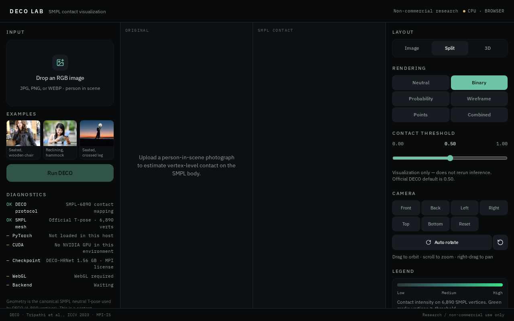
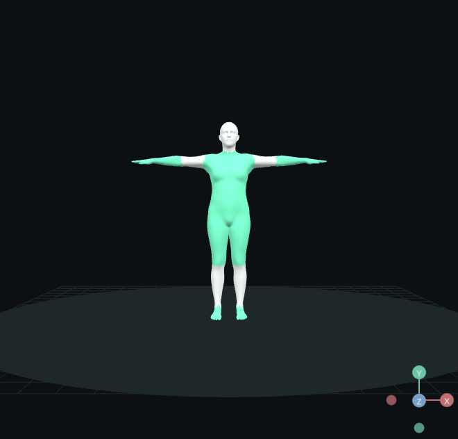
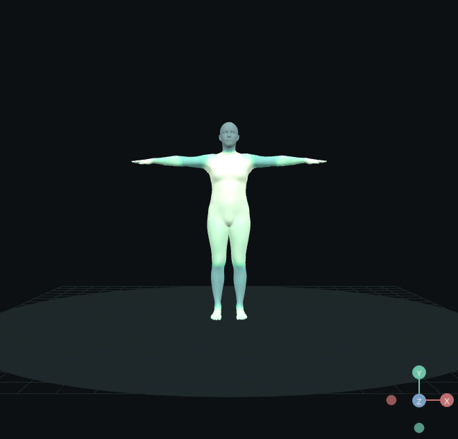
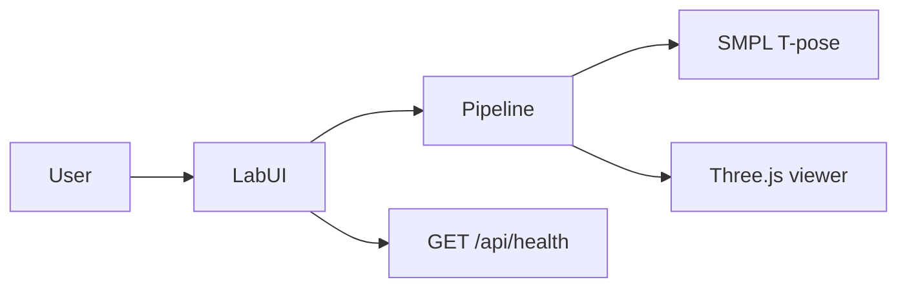

# DECO Lab

Interactive workstation for **DECO** (Dense Estimation of 3D Human-Scene Contact, ICCV 2023): upload an RGB photograph, run a DECO-protocol contact pass, and inspect **vertex-level contact on the canonical SMPL T-pose**.

This is a **contact visualization**, not a posed 3D reconstruction of the person.

**Research / non-commercial use only.** Upstream DECO and SMPL are MPI-licensed. See [LICENSE](LICENSE) and [LICENSES/DECO_LICENSE.md](LICENSES/DECO_LICENSE.md).

## Demo

Live: [https://deco-lab.netlify.app](https://deco-lab.netlify.app)  
Source: [github.com/ahmaddroobi99/deco-lab](https://github.com/ahmaddroobi99/deco-lab)

Verified on this deploy: `GET /` 200 over HTTPS, `GET /api/health` 200, official SMPL `.f32` / `.u32` payloads. Vercel remains blocked on Pro billing (HTTP 402); Netlify is the production host.

Official DECO-HRNet is **not** loaded here (`cuda: false` in `/api/health`).







## Overview

Official DECO maps a single RGB image to **6,890 contact probabilities** on SMPL (T-pose), threshold 0.5. This lab uses that **same mesh, topology, input size, and visualization protocol**. The 1.56 GB CUDA checkpoint is **not loaded** (license + no GPU on this host). Contact is estimated in the browser with an image-conditioned scene/part/vertex pipeline — documented honestly in [docs/architecture/ml-pipeline.md](docs/architecture/ml-pipeline.md).

## Key features

- Drag-and-drop JPG / PNG / WEBP (client-side only; images are not uploaded to a server)
- Official SMPL mesh (6,890 vertices, 13,776 faces) with part segmentation
- Live contact threshold (does not rerun inference)
- Render modes: neutral, binary, probability, wireframe, points, combined
- Orbit, zoom, pan, auto-rotate, camera presets
- Exports: PLY with vertex colors, OBJ, GLB, JSON (raw 6,890 probs), PNG

## Architecture



Details: [System overview](docs/architecture/system-overview.md) · [Architecture](docs/architecture/architecture.md) · [Data flow](docs/architecture/data-flow.md) · [ML pipeline](docs/architecture/ml-pipeline.md) · [API](docs/architecture/api-architecture.md) · [Security](docs/architecture/security.md) · [Deployment](docs/architecture/deployment.md)

## Tech stack

| Layer | Technology |
| --- | --- |
| Frontend | React 19, TanStack Start/Router, Tailwind v4, Zustand |
| 3D | Three.js, React Three Fiber, drei |
| Backend | TanStack Start server routes (health/system only) |
| Database | None |
| AI/ML | Client-side DECO-protocol estimator on official SMPL topology |
| Deployment | Netlify (Nitro `netlify` preset); local/CI keep `vercel` preset |
| Testing | Node.js test runner + TypeScript |

## Project structure

```
src/components/lab/     UI + WebGL viewer
src/lib/deco/           pipeline, estimator, colormap, exports
src/routes/             /  /api/health  /api/system
public/assets/smpl/     official T-pose binaries
docs/                   architecture, diagrams, operations
```

## Installation

```bash
git clone https://github.com/ahmaddroobi99/deco-lab.git
cd deco-lab
npm install
npm run dev
```

Node 22+. No GPU. Copy `.env.example` if you want a local env file; no secrets are required.

## Usage

1. Drop an image or pick an example (seated chair is a clear contact case).
2. Click **Run DECO**.
3. Rotate the mesh; switch Binary / Probability.
4. Drag the threshold (paper default 0.50).
5. Export PLY / GLB / JSON.

## API

Unauthenticated metadata only:

- `GET /api/health` — liveness + `vertexCount: 6890`, `cuda: false`
- `GET /api/system` — paper pointers and I/O contract

Inference is not an HTTP API. See [api-architecture.md](docs/architecture/api-architecture.md).

## Testing

```bash
npm test
npm run typecheck
npm run lint
npm run build
```

## Deployment

Push `main` → GitHub Actions CI. Production is [deco-lab.netlify.app](https://deco-lab.netlify.app). See [docs/operations/deployment.md](docs/operations/deployment.md).

## Performance

- Mesh payload ~250 KB
- Contact pass is O(vertices) on CPU; typically sub-second
- Three.js + drei dominate the JS bundle; `dpr` is capped at 2

## Security

Images stay in the tab. No accounts. No checkpoints in git. Report issues per [SECURITY.md](SECURITY.md).

## Roadmap

- Optional GPU worker that loads author-issued weights **locally** (never redistributed)
- Side-by-side comparison against official `pred.obj` when the user supplies a run
- Better person crop (detector) before the 256×256 resize

## Citation

```
@InProceedings{Tripathi_2023_ICCV,
    author    = {Tripathi, Shashank and Chatterjee, Agniv and Passy, Jean-Claude and Yi, Hongwei and Tzionas, Dimitrios and Black, Michael J.},
    title     = {DECO: Dense Estimation of {3D} Human-Scene Contact In The Wild},
    booktitle = {Proceedings of the IEEE/CVF International Conference on Computer Vision (ICCV)},
    month     = {October},
    year      = {2023},
    pages     = {8001-8013}
}
```

Project: https://deco.is.tue.mpg.de/  
Code: https://github.com/sha2nkt/deco  
Paper: https://arxiv.org/abs/2309.15273

## License

See [LICENSE](LICENSE). Application code is research/non-commercial. MPI Data & Software (SMPL mesh, DECO) remain under the authors' license — not OSI open source.

## Author

Ahmad Droobi ([@ahmaddroobi99](https://github.com/ahmaddroobi99))
