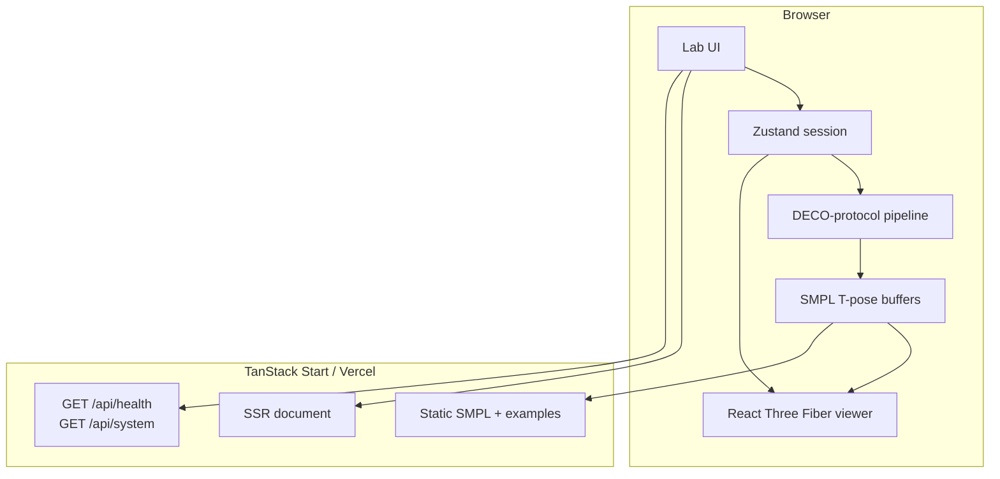

# Architecture

TanStack Start (Vite + Nitro) hosts a single-page lab. Inference is a
pure TypeScript pipeline that preserves DECO I/O:

`RGB image → 256×256 → 6890 contact probabilities → colored SMPL mesh`

## Layers

1. **Presentation** — `src/components/lab/*`, Tailwind tokens in `src/styles.css`
2. **Session state** — `src/lib/deco/store.ts`
3. **Domain** — image cues, pose mixture, per-vertex classifier + Laplacian smoothing
4. **Assets** — `public/assets/smpl/*.f32|u32|json`
5. **Host** — file routes under `src/routes`, Nitro on Vercel

Auth and Postgres scaffolding in `src/lib/auth` and `src/lib/db.ts` is
**unused** by the lab (opt-in platform code).

## Why client-side inference

The official checkpoint cannot be hosted here (size, CUDA, MPI
redistribution). The estimator is documented as a protocol-faithful
stand-in so the viewer, exports, and I/O contract can still be tested.
See [decisions/0001-client-side-estimator.md](./decisions/0001-client-side-estimator.md).
