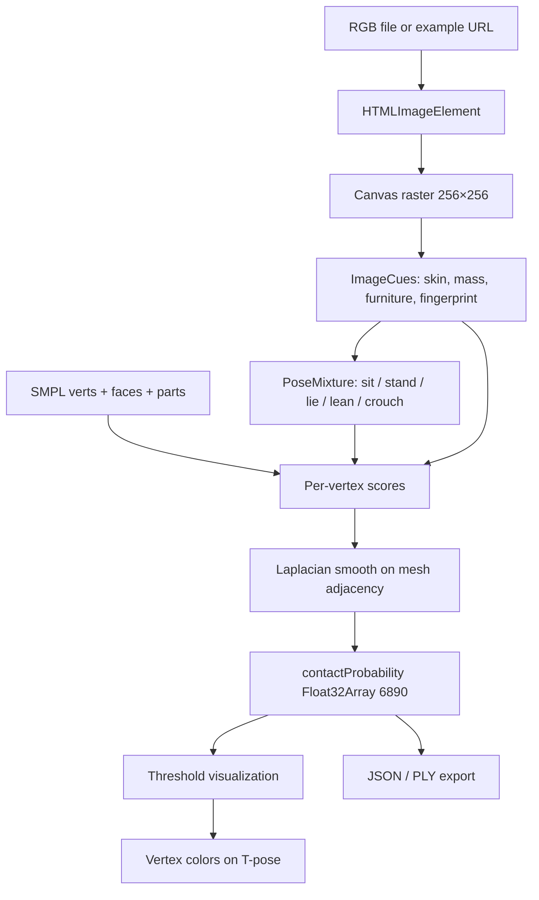

# Data flow

Shapes (enforced in tests):

| Stage | Shape |
| --- | --- |
| Model input | `256 × 256 × RGB` |
| Contact | `(6890,)` in `(0, 1)` |
| Vertices | `(6890, 3)` float32 |
| Faces | `(13776, 3)` uint32 |
| Default threshold | `0.5` |

Thresholding is visualization only. The stored probability vector is
unchanged when the slider moves.
