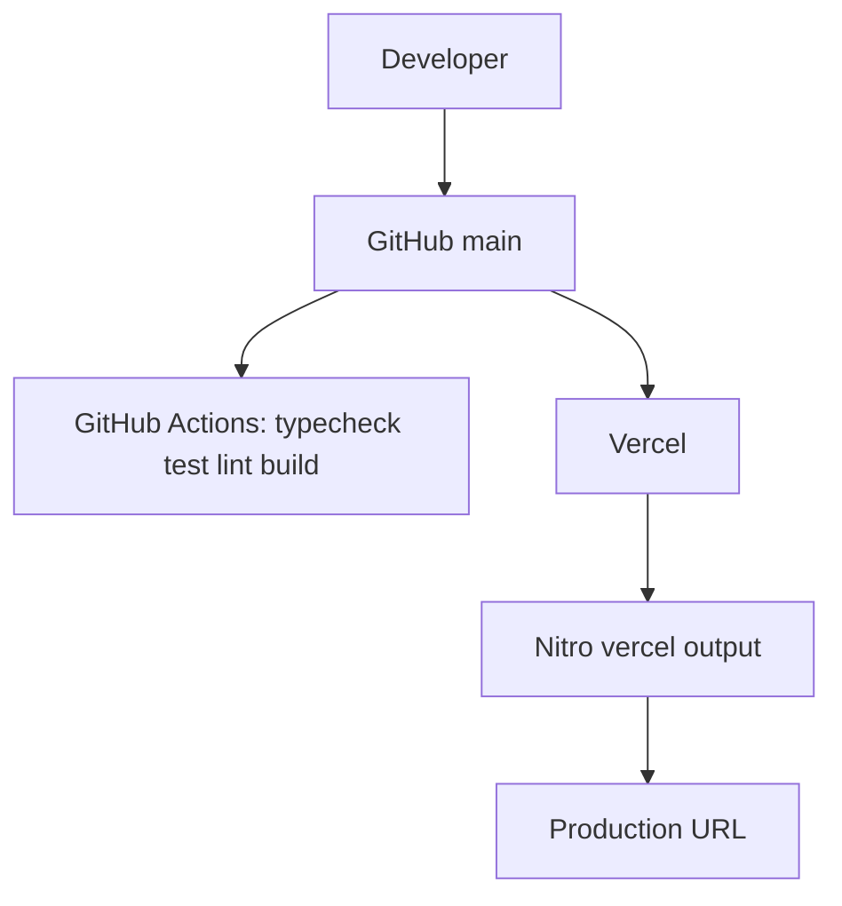

# Deployment architecture

- **Build:** `npm run build` → Vite client + SSR + Nitro `vercel` preset
- **Dev:** `npm run dev` binds `0.0.0.0:8080` (App Builder preview contract)
- **CI:** `.github/workflows/ci.yml`
- **Hosting:** Vercel project linked to `ahmaddroobi99/deco-lab`

No extra env vars are required for the default lab.

See also [../operations/deployment.md](../operations/deployment.md).
