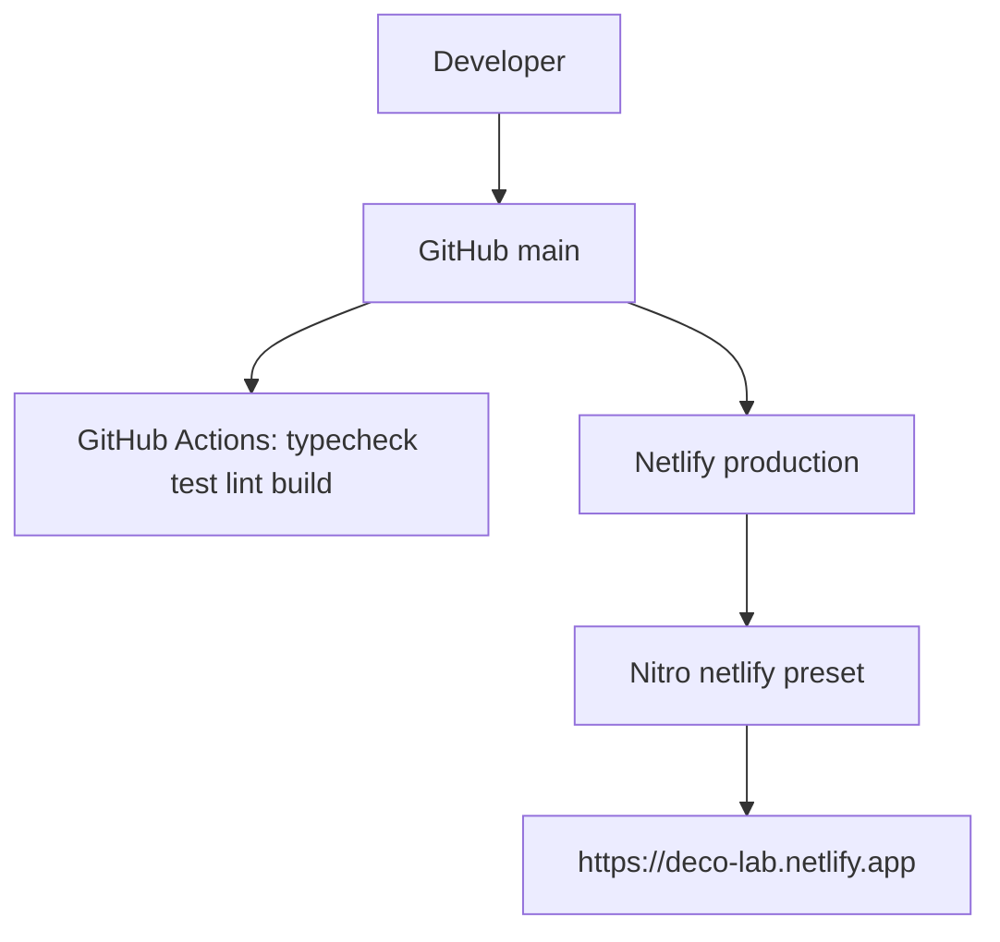

# Deployment architecture

- **Build:** `npm run build` → Vite client + SSR
  - Netlify CI (`NETLIFY=true`): Nitro `netlify` preset → `dist` + `.netlify/functions-internal`
  - Local / GitHub Actions: Nitro `vercel` preset (App Builder / Vercel-ready)
- **Dev:** `npm run dev` binds `0.0.0.0:8080`
- **CI:** `.github/workflows/ci.yml`
- **Hosting:** [deco-lab.netlify.app](https://deco-lab.netlify.app) (team `ahmad-droobi1999`)

No extra secrets. `VITE_AUTH_ENABLED=false`.

## Production (2026-09-01)

| Check | Result |
| --- | --- |
| `https://deco-lab.netlify.app/` | HTTP 200, `text/html` |
| HTTP → HTTPS | 301 |
| `GET /api/health` | 200, `cuda: false`, `vertexCount: 6890` |
| `/assets/smpl/smpl_neutral_tpose.f32` | 200, 82680 bytes |
| Client JS MIME | `application/javascript` |

Vercel project creation on `ahmads-projects-76bdf265` still returns HTTP 402 (`resource_creation_blocked`). Not reused `time7`.

See also [../operations/deployment.md](../operations/deployment.md).
