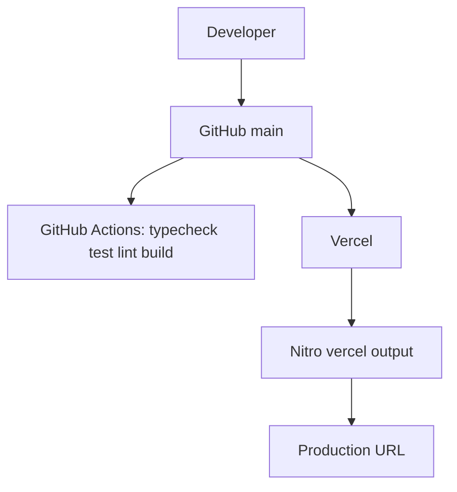

# Deployment architecture

- **Build:** `npm run build` → Vite client + SSR + Nitro `vercel` preset
- **Dev:** `npm run dev` binds `0.0.0.0:8080` (App Builder preview contract)
- **CI:** `.github/workflows/ci.yml`
- **Hosting:** Vercel project intended as `ahmaddroobi99/deco-lab`

No extra env vars are required for the default lab.

## Current production status (2026-09-01)

`vercel create_git_project` / `deploy_to_vercel` against team
`team_9XK1FiVNJIf4Xk3YixRN0544` (`ahmads-projects-76bdf265`) fail with
**HTTP 402** `resource_creation_blocked`:

> Your account has been suspended. To reactivate your subscription, add a valid payment method.

Existing linked project on that team is `time7` (`ahmaddroobi99/time7`) — not reused.

After billing is reactivated:

1. Link `ahmaddroobi99/deco-lab` to a new Vercel project named `deco-lab`
2. Production branch `main`, build command `npm run build`
3. Confirm `GET /` and `GET /api/health` return HTTP 200 over HTTPS

See also [../operations/deployment.md](../operations/deployment.md).
